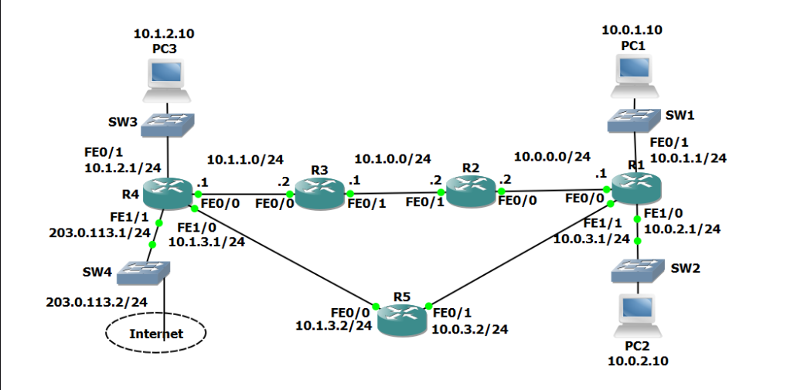

What I learned, static routes can easily be combined into a route summarization route.
For example, we have many routes with the same prefix of 10.1.x.x, like 10.1.1.0/24, 10.1.0.0/24, 10.1.2.0/24.
The subnet masks on all of them are /24 and they share 10.1.x.x, so we can turn it into 10.1.0.0 255.255.0.0 since the first 2 octers will always be the same except the last one.

Setting a floating static route is for backup routes incase dynamic routing protocols fail. Remember to set the AD number to a slightly lower number than a protocol's.

Commands Learned (assuming we're on Router 1):
    Floating static route: **R1** conf term --> ip route 10.1.0.0 255.255.0.0 10.0.3.2 95