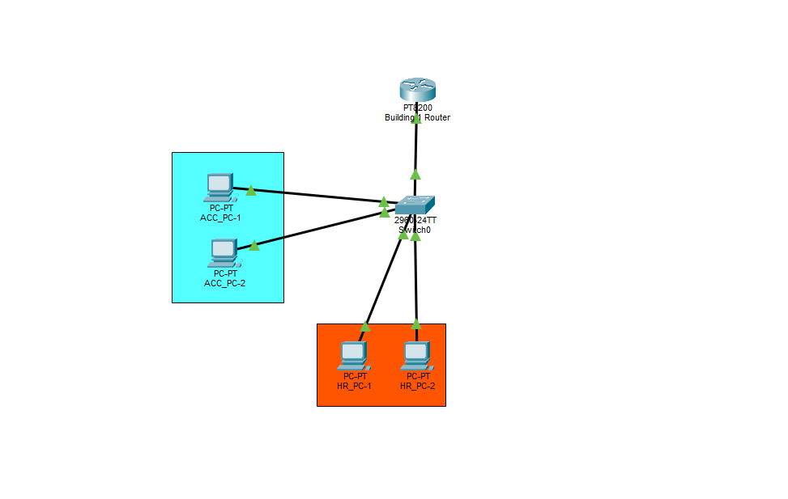

# 🌐Personal Network Design Lab

Network Implementation from scratch

## 📖 Overview

Hi, this is my own network implementation that I come up from a blank canvas. I will be building it from very basic network topology,
and over time I'll keep adding onto it to make it more complex and dynamic. I will log each day that I get onto this lab and design.

## 🚧 Project Status

| Detail | Status |
| --- | --- |
| Day Zero | October 16, 2026 |
| Days logged | 2 |
| Current focus | VLANs and switching |
| Next goal | Add a second router to another building, and add a DNS server |

## 📝 Lab Journal

### 📍 Day 1: Basic Topology and DHCP

October 16, 2026 (10/16/2026)

#### Objective

Build a basic Accounting network and configure dynamic IP address assignment with DHCP.

#### Network Topology


#### Description

A basic and minimal set up in which we have a router that is configured to provide DHCP server as well. Both computers are receiving ip dynamically from the router. The switch is handling distributing the IP to the MAC addresses of the computers. 

==Network Description==:

```
Network Name: Accounting_Network
Network IP: 192.168.1.0/24
Range: 192.168.1.10 - 192.168.1.255
Reservations: 192.168.1.1 - 192.168.1.9 
```


#### Next Steps

- Add a second network.
- Test connectivity between hosts on both networks.

---


### 📍 Day 2: VLANs 

October 18, 2026 (10/18/2026)

#### Objective

Adding a separated network using the same switch and router, basically VLANs.

#### Network Topology



#### Description

Additional network was added into the existing previous topology. 2 VLANs: VLAN10 - Accounting department, VLAN20 - HR department. 
The switch configuration was added to accomodate VLAN10 on FastEthernet port 2 and 3.
VLAN20 is on port FastEthernet 4,5.
Native VLAN is on port FastEthernet1.

Switch GigabitEthernet0/1, which is the trunk port is connected to Router GigatbitEthernet0/0/0.


**Switch Trunks Interface**:
```
Port        Mode         Encapsulation  Status        Native vlan
Gig0/1      on           802.1q         trunking      1

Port        Vlans allowed on trunk
Gig0/1      10,20

Port        Vlans allowed and active in management domain
Gig0/1      10,20

Port        Vlans in spanning tree forwarding state and not pruned
Gig0/1      20
```

**Switch VLANs**:
```
VLAN Name                             Status    Ports
---- -------------------------------- --------- -------------------------------
1    default                          active    Fa0/1, Fa0/6, Fa0/7, Fa0/8
                                                Fa0/9, Fa0/10, Fa0/11, Fa0/12
                                                Fa0/13, Fa0/14, Fa0/15, Fa0/16
                                                Fa0/17, Fa0/18, Fa0/19, Fa0/20
                                                Fa0/21, Fa0/22, Fa0/23, Fa0/24
                                                Gig0/2
10   Accounting                       active    Fa0/2, Fa0/3
20   HR                               active    Fa0/4, Fa0/5
1002 fddi-default                     active    
1003 token-ring-default               active    
1004 fddinet-default                  active    
1005 trnet-default                    active    
```

**Router IP Interfaces**:
```
Interface              IP-Address      OK? Method Status                Protocol 
GigabitEthernet0/0/0   unassigned      YES manual up                    up 
GigabitEthernet0/0/0.10192.168.10.1    YES manual up                    up 
GigabitEthernet0/0/0.20192.168.20.1    YES manual up                    up 
GigabitEthernet0/0/1   unassigned      YES unset  down                  down 
GigabitEthernet0/0/2   unassigned      YES unset  down                  down 
GigabitEthernet0/0/3   unassigned      YES unset  down                  down
```

### Commands that I learned:
**Switch commands**:
- interface gigabitEthernet 0/0: enter the config-if mode for gigabitEthernet 0/0 interface.
- switchport mode trunk: turn a switch port into a trunk port.
- switchport trunk allowed add: add the VLANs that is allowed through the trunk port.

**Router Commands**:
- interface gigabitEthernet 0/0/0.10: creates a subinterface on the physical 0/0/0 port.
- encapsulation dot1Q 10: tell the subinterface to handle Ethernet traffic tagged with VLAN10.
- ip dhcp pool VLAN10: enter the add ip pool configuration mode for VLAN10 network.

**Both**:
- show vlan brief: show vlan on the switch/router.
- show interfaces trunk: show trunk interfaces on switch/router.

#### Next Steps

- Add a different router to another building.
-Add a DNS server

---