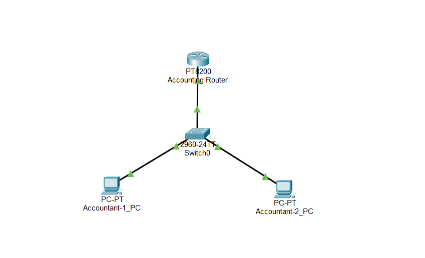

# 🌐Personal Network Design Lab

Network Implementation from scratch

## 📖 Overview

Hi, this is my own network implementation that I come up from a blank canvas. I will be building it from very basic network topology,
and over time I'll keep adding onto it to make it more complex and dynamic. I will log each day that I get onto this lab and design.

## 🚧 Project Status

| Detail | Status |
| --- | --- |
| Day Zero | October 16, 2026 |
| Days logged | 1 |
| Current focus | Basic topology and DHCP |
| Next goal | Add a second network and configure communication between networks |

## 📝 Lab Journal

### 📍 Day 1: Basic Topology and DHCP

October 16, 2026 (10/16/2026)

#### Objective

Build a basic Accounting network and configure dynamic IP address assignment with DHCP.

#### Network Topology




#### Description

A basic and minimal set up in which we have a router that is configured to provide DHCP server as well. Both computers are receiving ip dynamically from the router. The switch is handling distributing the IP to the MAC addresses of the computers. 

==Network Description==:

```
Network Name: Accounting_Network
Network IP: 192.168.1.0/24
Range: 192.168.1.10 - 192.168.1.255
Reservations: 192.168.1.1 - 192.168.1.9 
```


#### Next Steps

- Add a second network.
- Test connectivity between hosts on both networks.

---