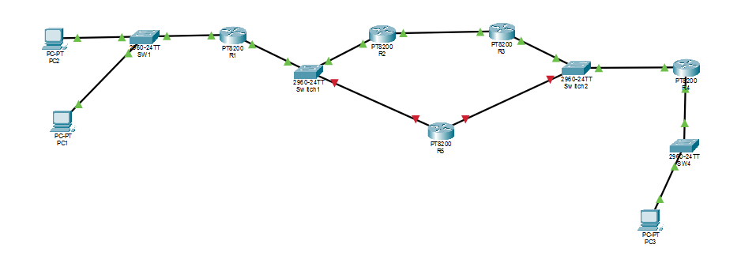
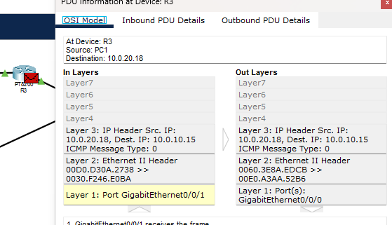
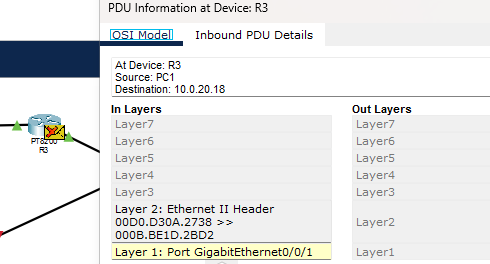

### Expanded Static Routing and Route Summary

One cool problem I discovered is that if I disabled the interfaces between R5 to R1, and R5 to R4. But I don't turn off the ip route of R4 to R5 while R4 to R3 route is activated. R4 actually will still try to load balance by choosing either path to forward packets.
So when that happens, some packets that are forwarded to R5 route will be dropped.

Explanation:

- The expected packet details at R3 going from R4 -> R3 should be: 

- In that you can see that the Dest IP is our origin start of PC1.
- The Layer 2 is also correct: As that is the MAC of R4(gi0/0/0) going into MAC of R3(gi0/0/1).
- Yet, on some failed packets, this is what it looks like:

- The best explanation for this issue is that disabling the interfaces alone, doesn't stop R4 from trying to load balance the packet to R5 still. Because the routes on R4 still contains both next hops to 10.0.0.0/15
- Which means R4 will still try to load balance, by sending the packet using a different route next turn.
- So when the failed packet reaches R3, and R3(gi0/0/0) is expecting to receive it's MAC address, it instead receives the MAC for R5(gi0/0/0) instead. Thus R3 just drops it.

To replicate this issue: 
- shutdown both interfaces on R5 going into R1 and R4.
- leave ip route from R5 to R4 on.
- to check, run show ip route and make sure that it matches this:

To fix this: simply remove the static route on R4 to R5, and only letting R4 to R3 be on at the time, or whichever routes are still physically connected.