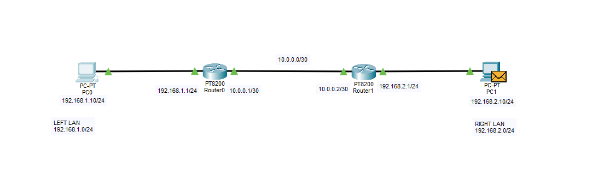

### Static Routing
Lab structure:

Commands:
- ip route *destination_network_ip* *subnet_mask* *next_hop_ip*
    - next_hop_ip is actually the ip address of the interface that the traffic is travelling through to get to that destination network.
    - For example ip route 192.168.2.0 255.255.255.0 10.0.0.2 means that traffic that wants to get into 192.168.2.0/24 must go through 10.0.0.2 interface (the neighbor's router interface that connects between your current router and itself - R1 to R2).
    - Another note to remember is that the ip route command is for a different network of your current's, and the next hop is the **NEIGHBORING** router.